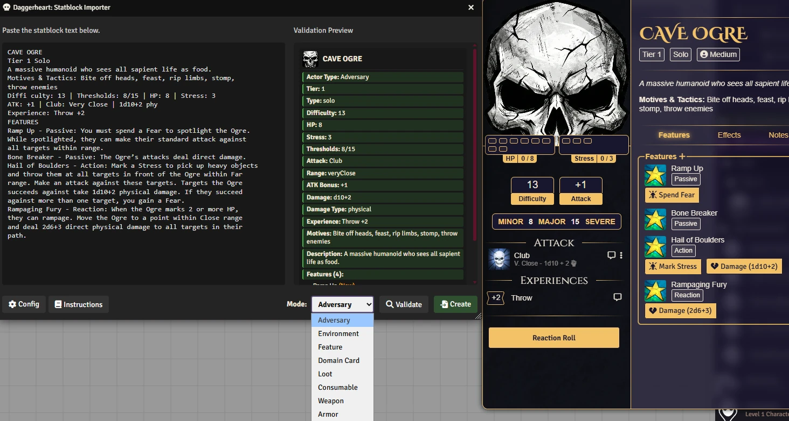
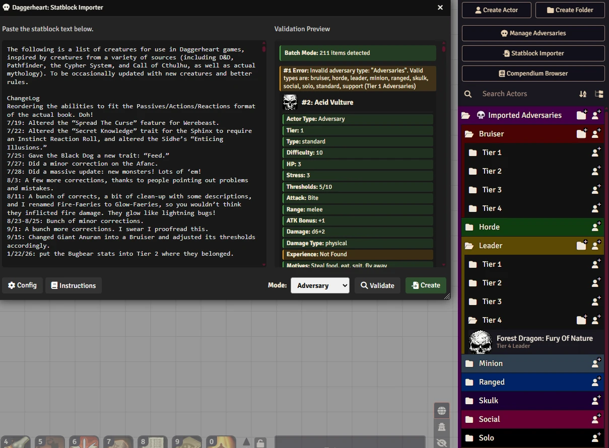
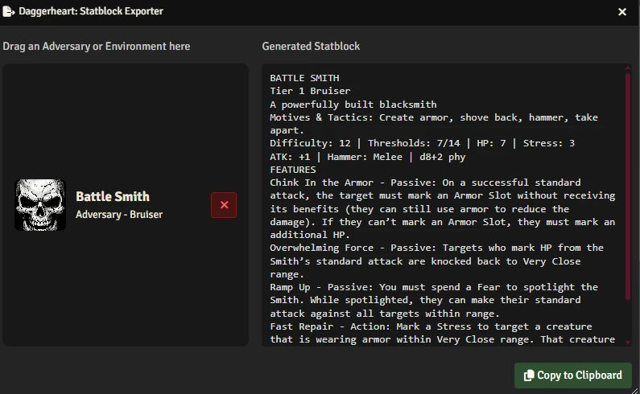
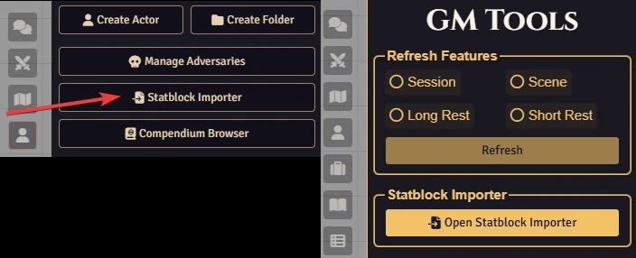
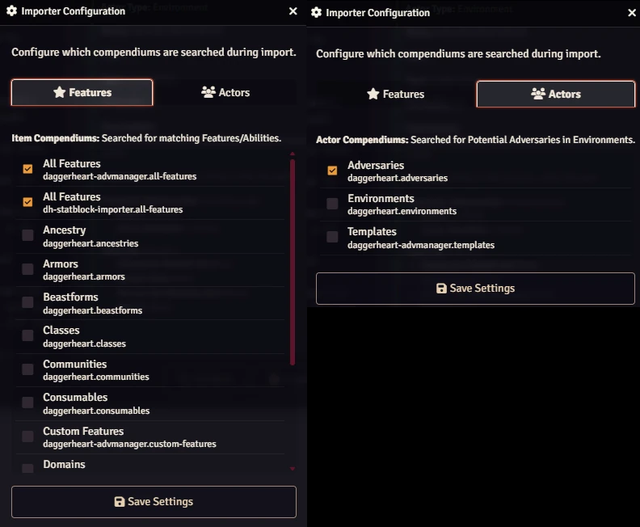

# Daggerheart: Stats Toolbox

Daggerheart: Stats Toolbox creates Foundry actors and items from statblock text. Paste an adversary or environment copied from a PDF, click **Validate** to see what was read, then **Create** builds the actor with its stats, attack, experiences and features, including the actions a feature describes. It also imports weapons, armor, loot, consumables, domain cards and standalone features, and works in reverse, turning an adversary, environment, class, ancestry or community back into text.

<p align="center"></p>

[](https://buymeacoffee.com/mestredigital) [](https://mestredigital.online/pages/projetos-en)

## What it imports

From an adversary statblock it reads the Tier, Type, Difficulty, HP, Stress, damage thresholds, the attack (bonus, name, range and damage), the experiences and the features. From an environment it reads the impulses, the Difficulty and the Potential Adversaries. Weapons, armor, loot, consumables, domain cards and features each have their own mode.

You can paste as many statblocks as you want at once, and each one becomes its own actor or item.

Before creating a feature, the module looks for one with the same name in the compendiums you selected. When it finds one, the actor gets that feature instead of a new copy. The groups listed under Potential Adversaries are linked to actors in your compendiums the same way. The preview marks each feature as Compendium or New, so you see what was found before anything is created.

The prompt questions that end environment features, and any text wrapped in `*asterisks*`, become GM-only secret blocks.

Everything you import goes into folders, one per kind of content.

<p align="center"></p>

Features get an icon for their type, Passive, Action or Reaction, so a sheet shows which features are passive or reactions without opening them.

## Turning an actor back into text

The exporter writes a statblock from your homebrew. Drop an adversary, environment, class, ancestry or community into it and copy the text. Open it with **Create Statblock** in the Daggerheart Menu, or with this macro:

```
SI.CreateStatblock();
```

<p align="center"></p>

## How to use it

1. Open the importer with the button in the Daggerheart Menu or in the Actors directory, or with this macro:

   ```
   SI.Open();   
   ```

<p align="center"></p>

2. Copy the statblock text from a PDF or document and paste it into the left panel. You can paste as many as you want.

3. Click **Validate** to preview the data.

4. Click **Create** to make the adversary, environment, weapon, armor, loot, consumable, domain card or feature.

### Settings

Click **Config** in the importer window to choose which compendiums are searched for features and for Potential Adversaries. The same window sets the folder names, the separator for bulk imports, how GM prompts become secrets, and the feature icons.

<p align="center"></p>

## Formatting guide

The importer reads best when the text follows the recommended format.

[Read the Formatting Wiki](https://github.com/brunocalado/dh-statblock-importer/wiki)

[How to Use Unformatted Stats](https://github.com/brunocalado/dh-statblock-importer/wiki/How-to-Use-Unformatted-Stats)

## Installation

Install it from the Foundry VTT module browser, or use this manifest link:

```
https://github.com/brunocalado/dh-statblock-importer/releases/latest/download/module.json
```

It needs Foundry VTT v14 and the Daggerheart system 2.12.8 or newer.

## Changelog

You can read the full history of changes in the [CHANGELOG](CHANGELOG.md).

## ⚖️ Credits and License

* **Code License:** GNU GPLv3.

* [skull](https://unsplash.com/license)

* **Disclaimer:** This module is an independent creation and is not affiliated with Darrington Press.

# 🧰 My Daggerheart Modules

| Module | Description |
| :--- | :--- |
| 💀 [**Adversary Manager**](https://github.com/brunocalado/daggerheart-advmanager) | Scale adversaries instantly and build balanced encounters. |
| 🖼️ [**Art Mapper**](https://github.com/brunocalado/dh-assets) | Automatically assigns artwork to system compendiums, actors, tokens, and custom module content — keeping your visuals organized and up to date. |
| 🐉 [**Colossus**](https://github.com/brunocalado/dh-colossus) | Manage massive multi-part boss encounters with independent HP per part and a single shared stress pool. |
| 💥 [**Critical**](https://github.com/brunocalado/daggerheart-critical) | Animated criticals. |
| 💠 [**Custom Stat Tracker**](https://github.com/brunocalado/dh-new-stat-tracker) | Add custom trackers to actors. |
| ☠️ [**Death Moves**](https://github.com/brunocalado/daggerheart-death-moves) | Enhances the Death Move moment with a dramatic interface and full automation. |
| 📏 [**Distances**](https://github.com/brunocalado/daggerheart-distances) | Visualizes combat ranges with customizable rings and hover calculations. |
| 📦 [**Extra Content**](https://github.com/brunocalado/daggerheart-extra-content) | Homebrew content pack. |
| 😱 [**Fear Tracker**](https://github.com/brunocalado/daggerheart-fear-tracker) | Adds an animated slider bar with configurable fear tokens to the UI. |
| 🧟 [**Horde**](https://github.com/brunocalado/dh-horde) | Explode single horde tokens into dozens of individual tokens and manage their movement and stats automatically. |
| 🎁 [**Mystery Box**](https://github.com/brunocalado/dh-mystery-box) | Introduces mystery box mechanics for random loot and surprises. |
| 📝 [**Nice Sheets**](https://github.com/brunocalado/dh-nice-sheets) | An alternative character sheet with a resource sidebar, ranked trait plaques, and the character's art filling the background. |
| ⚡ [**Quick Actions**](https://github.com/brunocalado/daggerheart-quickactions) | Quick access to common mechanics like Falling Damage, Downtime, etc. |
| 📜 [**Quick Rules**](https://github.com/brunocalado/daggerheart-quickrules) | Fast and accessible reference guide for the core rules. |
| 🤖 [**Resource Macros**](https://github.com/brunocalado/daggerheart-fear-macros) | Automatically executes macros when the Fear, Hope, Stress, HP, or Armor resources change. |
| 🎲 [**Stats**](https://github.com/brunocalado/daggerheart-stats) | Tracks dice rolls from GM and Players. |
| 🧠 [**Stats Toolbox**](https://github.com/brunocalado/dh-statblock-importer) | Import actors using a statblock. |
| 🛒 [**Store**](https://github.com/brunocalado/daggerheart-store) | A dynamic, interactive, and fully configurable in-game store. |
| 🔍 [**Unidentified**](https://github.com/brunocalado/dh-unidentified) | Obfuscates item names and descriptions until they are identified by the players. |
| 🌌 [**Void**](https://github.com/brunocalado/the-void-unofficial) | Unofficial module that brings The Void playtesting content — experimental classes, subclasses, ancestries, communities, adversaries, loot, weapons, and more. |

# 🗺️ Adventures

| Adventure | Description |
| :--- | :--- |
| ✨ [**I Wish**](https://github.com/brunocalado/i-wish-daggerheart-adventure) | A wealthy merchant is cursed; one final expedition may be the only hope. |
| 💣 [**Suicide Squad**](https://github.com/brunocalado/suicide-squad-daggerheart-adventure) | Criminals forced to serve a ruthless master in a land on the brink of war. |
